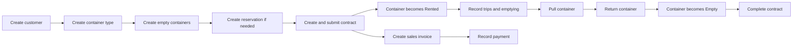

# BADR Container Management

## Detailed User and Workflow Guide

This manual explains how operators, managers, accounts staff, fleet staff, report users, and administrators use BADR Container Management. It covers setup, the complete rental lifecycle, field behavior, approvals, accounting integration, reports, validation, cancellations, and troubleshooting.

Open the application from **Desk > Container Management**.

## Main workflow

A reservation is optional. A customer can proceed directly to a contract when a container is available.

## Before daily use

An administrator should prepare these records once:

1. **Company and chart of accounts** in ERPNext.
2. **Customers** in the standard ERPNext Customer list.
3. **Rental Item** in the standard ERPNext Item list. This item is used on rental invoices.
4. **Container Types**, such as 20 FT, 40 FT, and 40 FT High Cube.
5. **Containers**, one record for each physical container.
6. **Vehicles and Drivers** for trucks and drivers. The app uses ERPNext's standard Vehicle and Driver records.
7. **Tax templates**, when prices include or exclude VAT.
8. **Users and roles** for operations, accounts, fleet management, and reporting.

## Container records

Create one **Container** record for each physical container. Give it a clear ID, select its type, and add its condition and remarks.

New containers must begin as **Empty**. The current customer, contract, location, and status are updated by submitted transactions. Staff should use movements and contracts instead of changing these values manually.

### Container statuses

| Status | Meaning |
| --- | --- |
| Empty | Available and not assigned to a customer |
| Rented | Assigned to an active customer contract |
| Late | The rental end date has passed while the container is still rented |
| Pull | The container has been requested or collected for return, but the rental assignment has not been closed |

## Reservations

Use **Rent Reservation** when a customer wants to reserve capacity before signing a contract.

1. Click **New Reservation**.
2. Select the customer and container type.
3. Enter the reservation period, quantity, and rate.
4. Optionally select a specific container. A specific container reservation must have quantity 1.
5. Save and submit the reservation.
6. Use **Confirmed** when the customer confirms.
7. Use **Completed** after the reservation has been fulfilled.

The system prevents overlapping reservations when there are not enough empty containers. Cancelled and completed reservations no longer reserve capacity.

## Rental contracts

Use one **Container Contract** for Rubble, Trash, or Unlimited Contract.

### Rubble and Trash contracts

Enter:

- Customer, company, currency, location, and dates
- Container or containers
- Number of trips and rate
- Rental Item
- Tax treatment and tax template when applicable

The basic amount is:

`Number of Trips × Rate = Total`

When several containers are added, the contract totals their trip quantities and amounts.

### Unlimited contracts

Unlimited contracts do not have a trip limit. Enter the customer, location, dates, Rental Item, tax information, and the amount to invoice for the current billing period.

The application does not decide the monthly or recurring billing schedule. Accounts staff should create each invoice according to the agreed billing cycle.

### Tax treatment

| Tax treatment | Result |
| --- | --- |
| Price Includes Tax | The entered amount already includes VAT |
| Price Excludes Tax | VAT is added to the entered amount |
| Exempt | No VAT is added |

Tax calculations use ERPNext's Sales Taxes and Charges Template and Sales Invoice calculation engine.

### Submitting a contract

1. Save the contract and review its amount, containers, dates, and tax treatment.
2. Submit it.
3. Containers listed in the contract become **Rented** and are linked to the customer and contract.

A container cannot be assigned if it is already rented, reserved for another customer, or assigned to another active contract.

## Container movements

Every physical change should be recorded in **Container Movement**. This creates the container's historical timeline.

| Movement | Use it when | Container result |
| --- | --- | --- |
| Delivery | Delivering an empty container to a customer | Rented |
| Transfer | Moving a rented container between locations | Assignment stays active; location changes |
| Pull or Pickup | Collecting or preparing to collect the container | Pull |
| Return | Closing the physical rental and returning the container | Empty; customer and contract are cleared |
| Emptying | Recording an emptying operation | Rental assignment remains active |
| Replacement | Use the Container Replacement form instead | Old container returns and new container is rented |

Use the workspace quick actions **Pull Container** and **Return Container** for common movements.

Movements must be entered in time order. If a submitted movement must be cancelled, cancel later dependent operations first. Cancellation restores the container's previous state.

## Trips

Use **Container Trip** for operational trips.

1. Select the customer, contract, container, truck, and driver.
2. Enter pickup and delivery information.
3. Keep planned, assigned, and in-transit trips as drafts.
4. Set the status to **Delivered** or **Returned** and submit the trip after it is completed.

Each submitted completed trip uses one trip from a limited contract.

Example:

- Allowed trips: 10
- Completed trips: 3
- Remaining trips: 7

The system stops additional trips when the limit is reached. A Container Manager can permit extra trips by selecting the override option and entering a reason. Unlimited contracts do not have a trip limit.

A trip with status Returned means the trip is finished. It does not end the customer's rental. Use a **Return** movement to make the physical container Empty.

## Emptying a container

Use **Container Emptying** to record the emptying date, location, condition before and after, charges, and remarks.

Submitting an emptying record keeps the container assigned to the same customer and contract. It does not return the container to inventory.

## Replacing a container

Use **Container Replacement** when a customer keeps the rental but receives a different container.

1. Select the customer and active contract.
2. Select the old rented container.
3. Select a different empty container.
4. Enter the date, reason, conditions, and any charge.
5. Submit the replacement.

The old container becomes **Empty**, and the new container becomes **Rented** under the same customer and contract.

## Pulling and returning a container

These are two separate steps:

1. Submit a **Pull** movement when the container is requested or collected for return. Its status becomes Pull, but its customer and contract remain linked.
2. Submit a **Return** movement when the return is complete. Its status becomes Empty, and its customer and contract are cleared.

This separation shows which containers are still in the return process.

## Completing a contract

A Container Manager can use **Complete Contract** after every assigned container has been returned.

The system will not complete a contract while it still has assigned containers. Submitted invoices remain in ERPNext and must be handled according to normal accounting procedures.

## Invoices and payments

### Create an invoice

1. Open an active submitted contract.
2. Click **Create Sales Invoice**.
3. Review the draft invoice, taxes, dates, and accounts.
4. Submit the Sales Invoice after approval.

For a fixed-trip contract, the contract action creates one normal rental invoice. Unlimited contracts may create repeated invoices using the current unlimited billing amount.

### Record a payment

Use ERPNext **Payment Entry** and allocate the receipt to the Sales Invoice. The app uses ERPNext's accounting ledger and does not keep a separate payment balance.

Use these standard reports for financial review:

- **Accounts Receivable** for customer outstanding balances
- **General Ledger** for customer statements
- **Sales Register** for sales and tax information
- **Payment Entry** for receipts and refunds

## Client withdrawals and refunds

A **Client Withdrawal** documents a customer refund already posted through ERPNext.

1. Create and submit a Payment Entry with Payment Type **Pay** for the customer.
2. Create Client Withdrawal.
3. Select the same customer, contract, and Payment Entry.
4. Enter the amount and reason, then submit.

The withdrawal record provides traceability. The Payment Entry remains the accounting transaction.

## Commissions

### Commission Rule

Create a rule for a Sales Person using either:

- Percentage of invoice net amount, or
- Fixed amount

A rule can apply to all customers, one customer, or one contract. Enter its effective dates and mark it active.

### Commission Entry

Create a Commission Entry after the related Sales Invoice is submitted. Select the contract, customer, sales person, invoice, and rule. The system calculates the amount and prevents a duplicate entry for the same invoice and sales person.

Commission Entry records the amount owed. Any actual commission payment should be posted through standard ERPNext accounting.

## Truck and fleet work

Use **Vehicle** for the truck master and **Driver** for drivers.

| Record | Purpose |
| --- | --- |
| Truck Oil Change | Oil-change date, kilometre reading, next service, supplier, and cost |
| Truck Permit | Permit number and expiry date |
| Truck KM Reading | Historical odometer readings |
| Purchase Invoice with Truck | Supplier expense posted to a specific truck |

Odometer readings normally cannot decrease. The Fleet Maintenance Due Report shows oil changes within 1,000 KM and expiry dates within 30 days, as well as overdue items.

## Dashboard and reports

The workspace dashboard shows:

- Total, Empty, Rented, Late, and Pull containers
- Active contracts
- Outstanding invoice balance
- Today's trips
- Pending returns

Useful operational reports include:

- Container Status Report
- Rented, Empty, Delayed, and Pull Containers Reports
- Container Movement Report
- Container Replacement Report
- Emptying Report
- General Contract Report
- Contract Trip Report
- Contract Payment and Outstanding Reports
- Commission Report
- Truck, Oil Change, Permit, KM, Spending, and Maintenance Due Reports

Use report filters to narrow results by customer, contract, container, date, or status.

## User roles

| Role | Main responsibility |
| --- | --- |
| Container Operator | Daily contracts, reservations, movements, trips, emptying, and replacement work |
| Container Manager | Operational control, cancellations, contract completion, and trip-limit overrides |
| Container Reports User | Read operational records and reports |
| Accounts User / Accounts Manager | Invoices, payments, refunds, commissions, and financial reports |
| Fleet Manager | Vehicles, oil changes, permits, kilometre readings, and fleet reports |

Users may also need access to linked ERPNext records such as Customer, Item, Company, Vehicle, and Driver.

## Common problems

### “Container is already assigned”

The container is Rented, Late, Pull, or otherwise linked to an active rental. Complete its Return movement before using it for another customer.

### “Insufficient available containers”

There are not enough Empty containers of that type for the requested reservation period. Reduce the quantity, change the dates, or make another container available.

### “Contract trip limit has been reached”

The completed trip count has reached the contract allowance. A manager can approve extra trips with an override reason, or the contract must be amended according to company policy.

### A container is still rented after a returned trip

Trip status does not close the rental. Submit a Container Movement with type **Return**.

### Contract cannot be completed

One or more containers are still assigned to it. Return every container first.

### Invoice cannot be created

Check that the contract is active and submitted, and that Company, Currency, Rental Item, and required tax template are set.

### Movement cannot be cancelled

A later movement or dependent operation exists. Cancel records from newest to oldest.

## Recommended daily routine

At the start of the day:

1. Review Today's Trips, Pending Returns, Late Containers, and Fleet Maintenance Due.
2. Assign trucks and drivers to draft trips.
3. Check reservations due to start.

During the day:

1. Record deliveries, transfers, pulls, returns, emptying, and replacements as they happen.
2. Complete and submit delivered trips.
3. Enter new kilometre readings and maintenance records.

At the end of the day:

1. Confirm that submitted movements match physical container locations.
2. Review incomplete trips and Pull containers.
3. Check invoices, receipts, and outstanding balances with Accounts.

## Important operating rule

The **Container** record shows the current physical state. Submitted **Container Movement** and related transactions provide the history. Always record the business event through its transaction form so the current state and history remain consistent.

## Detailed reference

### Contract status lifecycle

The Contract Status field is intentionally read-only. The system changes it through document actions so the status always agrees with the Frappe document state and the physical container assignments.

| User action | Document state | Contract status | Result |
| --- | --- | --- | --- |
| Save a new contract | Draft | Draft | The contract can still be edited and assigns no container |
| Submit the contract | Submitted | Active | Listed containers become Rented and receive the customer, contract, and location |
| Click Complete Contract | Submitted | Completed | The agreement is closed after all assigned containers have returned |
| Cancel the submitted contract | Cancelled | Cancelled | The submitted transaction is reversed subject to dependency checks |

Users should not type a status manually. Otherwise, an unsubmitted contract could appear Active, a cancelled document could still appear operational, or a contract could be completed while containers remain assigned.

The **Complete Contract** button is shown only when the contract is submitted and Active and the user has the **Container Manager** role. Completion is blocked while any Container still references the contract.

### Container Contract field reference

#### Common fields

| Field | Required | Purpose |
| --- | --- | --- |
| Contract Type | Yes | Select Rubble, Trash, or Unlimited Contract |
| Customer | Yes | ERPNext Customer signing the agreement |
| Status | System | Current lifecycle state |
| Contract Date | Yes | Date the agreement was created |
| Location | No | Main delivery or service location |
| Plot Number | No | Customer site reference |
| Plan Number | No | Customer plan or permit reference |
| Contract From | Yes | Start of the rental period |
| Contract To | Conditional | End of the rental period; cannot precede Contract From |
| Company | Yes | ERPNext company that will issue invoices |
| Currency | Yes | Contract and invoice currency |
| Rental Item | For billing | ERPNext Item placed on the Sales Invoice |
| Notes | No | Commercial or operational notes |

#### Rubble and Trash fields

| Field | Purpose |
| --- | --- |
| Classification | Links the contract classification to a Container Type |
| No. of Trips | Total allowed trips when the child table is not used |
| Container Size | Descriptive legacy size field |
| Price | Rate used in the basic calculation |
| Total | Read-only result of trips multiplied by price |
| Contract Cost | Read-only final contract amount before ERPNext posts the invoice |
| Trip Duration | Expected operational duration |
| Containers | One or more physical container assignments and row-level rates or limits |
| Used Trips | Read-only count of submitted Delivered or Returned trips |
| Remaining Trips | Read-only allowed trips minus used trips |
| Allow Extra Trips | Manager-controlled exception to the limit |
| Override Reason | Required explanation when extra trips are allowed |

The basic limited-contract calculation is:

`Number of Trips × Price = Total`

When rows exist in the Contract Containers table, the application totals the row quantities and values. Negative prices, quantities, and amounts are rejected.

#### Contract Containers child table

| Field | Purpose |
| --- | --- |
| Container | Physical unit assigned to the agreement |
| Container Type | Read-only type copied from the selected container |
| No Of Trips | Allowed trips for the row |
| Trip Duration | Expected duration for the row |
| Rate | Row rate |
| Total | Read-only row calculation |
| Start Date and End Date | Optional assignment-specific period |

The same container cannot be entered twice in a contract or assigned to conflicting active contracts.

#### Unlimited Contract fields

Unlimited Contract hides the limited trip and trip-price fields. Enter the customer, location, plot and plan numbers, dates, company, currency, Rental Item, tax information, notes, containers, and **Unlimited Billing Amount**.

Accounts users may create repeated draft invoices for the agreed billing periods. The application does not automatically decide a monthly billing date or submit a recurring invoice.

### Tax and invoice behavior

| Tax treatment | Contract and invoice behavior |
| --- | --- |
| Price Includes Tax | The entered amount includes VAT; ERPNext calculates the included portion with the selected Sales Tax Template |
| Price Excludes Tax | ERPNext adds tax from the selected Sales Tax Template |
| Exempt | The contract invoice action applies no sales tax rows |

The **Sales Tax Template** supplies ERPNext Sales Invoice tax rows. The retained **Tax Template** field supports Item Tax Template configuration where the company uses it. Always review the generated draft invoice because ERPNext, not the contract record, is the accounting authority.

To create an invoice:

1. Open a submitted Active contract.
2. Click **Create Sales Invoice**.
3. Review the draft customer, company, currency, item, rate, income account, cost center, due date, and taxes.
4. Submit the invoice only after Accounts approval.
5. Record the receipt with a standard ERPNext Payment Entry and allocate it to the invoice.

Limited contracts prevent unintended duplicate contract invoices. Unlimited contracts support repeated invoices using the current Unlimited Billing Amount.

### Reservation field reference and capacity rules

| Field | Purpose |
| --- | --- |
| Customer | Customer requesting capacity |
| Reservation Date | Date the request was received |
| From Date and To Date | Inclusive period being reserved |
| Container Type | Required size or category |
| Quantity | Positive number of units required |
| Container | Optional exact physical container; quantity must be one |
| Rental Rate | Proposed rate for reference |
| Status | System-managed Draft, Reserved, Confirmed, Cancelled, or Completed |
| Remarks | Customer or operating instructions |

The availability check counts overlapping active reservations and the currently Empty fleet of the selected type. A cancelled or completed reservation releases its capacity. The application does not assume a currently rented unit will return by a future reservation date.

### Movement validation and cancellation

Movement documents require the Container, Customer, Contract, Movement Type, and Movement Date. Truck, Driver, origin, destination, and remarks provide operational detail.

| Movement | Required starting condition | Result after submission |
| --- | --- | --- |
| Delivery | Empty container and Active contract | Rented; customer, contract, and destination are stored |
| Transfer | Container assigned to the selected customer and contract | Assignment stays active; location changes |
| Pull or Pickup | Container assigned to the selected customer and contract | Status becomes Pull; assignment remains linked |
| Return | Container assigned to the selected customer and contract | Status becomes Empty; customer and contract clear |
| Emptying | Container assigned to the selected customer and contract | Rental remains active and history is recorded |
| Replacement | Created through Container Replacement | Old unit returns and new unit is delivered |

The system stores a Previous State snapshot on each submitted movement. Cancelling the latest movement restores that state. When a later movement depends on it, cancel records from newest to oldest.

### Trip status and counting rules

| Trip status | Meaning | May be submitted as completed work |
| --- | --- | --- |
| Planned | Work is being planned | No |
| Assigned | Truck or team has been assigned | No |
| In Transit | Work is underway | No |
| Delivered | Delivery work is complete | Yes |
| Returned | Trip activity is complete and returned | Yes |
| Cancelled | Work will not be performed | No |

Each submitted Delivered or Returned trip uses one trip from a limited contract. Cancelling it removes that usage. Unlimited contracts are not restricted by the count.

`Remaining Trips = Allowed Trips − Submitted Delivered or Returned Trips`

The customer, contract, and container on a trip must agree with the current assignment. A Returned trip closes the trip activity only; submit a **Return movement** to end the physical rental.

### Emptying and replacement controls

Container Emptying requires the assigned Container, Customer, Contract, and Emptying Date. Location, condition before and after, charges, and remarks add operational detail. Submission preserves the same rental assignment. Charges are informational until Accounts creates the appropriate ERPNext sales transaction.

Container Replacement requires the same customer and Active contract as the old assignment. The old and new containers must be different, and the new unit must be Empty. Submission creates traceable Return and Delivery movements, makes the old unit Empty, and assigns the new unit as Rented.

### Accounting boundary

The application records rental operations and links them to ERPNext accounting. It does not maintain a second ledger.

| Business event | Record to use |
| --- | --- |
| Customer billing | Sales Invoice |
| Customer receipt | Payment Entry with Payment Type Receive |
| Customer refund | Payment Entry with Payment Type Pay, then Client Withdrawal for traceability |
| Sales return or credit note | ERPNext Sales Invoice return |
| Supplier expense | Purchase Invoice |
| Truck expense allocation | Submitted Purchase Invoice linked to the Vehicle where configured |
| Customer statement | General Ledger filtered by Customer |
| Customer outstanding | Accounts Receivable |

Client Withdrawal must reference a submitted refund Payment Entry for the same customer. It documents the reason and contract relationship but does not post money again.

### Commission calculation and traceability

A Commission Rule defines the Sales Person, optional customer or contract restriction, effective dates, and either a percentage or fixed amount. The rule must be active and valid on the invoice date.

A Commission Entry links the submitted Sales Invoice, contract, customer, sales person, and rule. For a percentage rule, the invoice net amount becomes the Base Amount and the system calculates the Commission Amount. For a fixed rule, it applies the configured amount. The system prevents a duplicate entry for the same invoice and sales person.

Submitting the entry changes its status to Accrued. Paying the commission remains a standard ERPNext accounting operation.

### Fleet field reference

The Truck links in the application use ERPNext **Vehicle**. Drivers use ERPNext **Driver**.

| Record | Key fields | Important behavior |
| --- | --- | --- |
| Truck KM Reading | Vehicle, reading date, current KM, driver, remarks | Shows previous KM and normally rejects a decrease |
| Truck Oil Change | Vehicle, oil type, date, current KM, next date, next KM, supplier, cost, Purchase Invoice | Stores maintenance history; Purchase Invoice posts the cost |
| Truck Permit | Vehicle, permit type, number, issue date, expiry date, attachment | Status is read-only Valid, Expiring, or Expired |

Fleet Maintenance Due uses planning thresholds of 30 days for expiry dates and 1,000 KM for oil service. It reports due work but does not create maintenance orders.

### Dashboard indicator definitions

| Indicator | What it counts or shows |
| --- | --- |
| Total Containers | All Container master records |
| Empty Containers | Units currently available |
| Rented Containers | Units with Rented status |
| Late Containers | Assigned units past the applicable end date |
| Pull Containers | Units in the return process |
| Active Contracts | Submitted contracts with Active status |
| Outstanding Payments | Outstanding submitted Sales Invoice value in the company context |
| Today's Trips | Today’s non-cancelled trip records |
| Pending Returns | Return-related work that is not yet complete |

Dashboard values depend on submitted records, company defaults, linked data, and the current user’s permissions.

### Complete report directory

#### Container and operations

| Report | Use |
| --- | --- |
| Container Status Report | Search containers by status, type, customer, contract, or location |
| Rented Containers Report | Review current rentals |
| Empty Containers Report | Review available capacity |
| Delayed Containers Report | Review Late containers |
| Pull Containers Report | Review units waiting for completed return |
| Container Movement Report | Review chronological physical history |
| Container Replacement Report | Review exchanged units |
| Emptying Report | Review emptying dates, conditions, and charges |
| Trip Returns Tracking Report | Track trip completion and return activity |

#### Contracts and finance

| Report | Use |
| --- | --- |
| General Contract Report | Contract customer, type, dates, status, and value |
| Customer Rental Report | Customer rental assignments |
| Contract Trip Report | Allowed, used, and remaining trips |
| Contract Payment Report | Invoiced and settled contract amounts |
| Contract Outstanding Report | Outstanding contract-linked invoice balances |
| Client Withdrawal Report | Customer refund traceability |
| Commission Report | Commission base, rule, and accrued amount |

#### Fleet

| Report | Use |
| --- | --- |
| Truck Report | ERPNext Vehicles used as trucks |
| Truck Oil Change Report | Service history and next service targets |
| Truck Permit Report | Permit validity and expiry |
| Truck KM Report | Historical odometer readings |
| Truck Spending Report | Submitted Purchase Invoices linked to trucks |
| Fleet Maintenance Due Report | Upcoming and overdue service or expiry items |

Standard ERPNext reports are reused for General Ledger, Accounts Receivable, Sales Register, Payment Entry, Purchase Register, Accounts Payable, Stock Balance, Stock Ledger, and deferred revenue. Salary and employee loan reports require the applicable HRMS or lending application.

### Server-side control summary

The application enforces these rules even when data comes from an API or import:

1. A rented container must have a customer and active contract.
2. One container cannot belong to conflicting active contracts.
3. A Delivery requires an Empty container and Active submitted contract.
4. Movement customer and contract must match the current assignment.
5. Contract and reservation end dates cannot precede their start dates.
6. Prices, trip counts, quantities, charges, commissions, and KM readings cannot be negative.
7. Limited contracts cannot exceed their trip allowance without manager override and a reason.
8. Unlimited contracts have no trip-count restriction.
9. Replacement requires different old and new containers.
10. Truck KM normally cannot decrease.
11. Contract completion requires all assigned containers to be returned.
12. Submitted history must be reversed through cancellation rather than manual state editing.

### Common end-to-end scenarios

#### Start a new rental

1. Create or verify the ERPNext Customer.
2. Create a reservation when capacity must be held.
3. Create the Container Contract and add one or more Empty containers.
4. Review pricing, tax treatment, dates, company, currency, and Rental Item.
5. Submit the contract.
6. Verify the contract is Active and its containers are Rented.
7. Record delivery or later movements as they happen.
8. Create the Sales Invoice and have Accounts review and submit it.
9. Record the customer receipt using Payment Entry.

#### End a rental

1. Submit a Pull or Pickup movement when the return begins.
2. Submit the Return movement when the unit reaches its final returned location.
3. Confirm the container is Empty and no longer has a customer or contract.
4. Repeat for every container on the contract.
5. Click Complete Contract.
6. Resolve remaining invoices, credits, or balances through ERPNext.

#### Exchange a container

1. Confirm the replacement unit is Empty.
2. Create Container Replacement under the current Active contract.
3. Enter the reason, condition details, and any charge.
4. Submit and verify the old unit is Empty and the new unit is Rented.

### Additional troubleshooting

#### Complete Contract button is missing

Confirm the contract is submitted, its status is Active, and the user has the Container Manager role.

#### Contract status cannot be edited

This is correct behavior. Save, Submit, Complete Contract, and Cancel control the field.

#### Dashboard value looks incorrect

Check the underlying report, document status, company defaults, linked contract or invoice, report filters, and user permissions. Draft and cancelled records are normally excluded.

#### Permit status looks outdated

The daily scheduler updates expiry states. An administrator can confirm that scheduler workers are running and execute the daily task during controlled troubleshooting.

### Data quality and audit practices

1. Use one permanent Container record for each physical unit.
2. Record physical events on the day they occur and in chronological order.
3. Use cancellation and amendment procedures for submitted records.
4. Avoid direct database changes or imports that bypass validation.
5. Reconcile Container Status Report with the physical yard regularly.
6. Reconcile Contract Outstanding Report with Accounts Receivable.
7. Review users and roles periodically.
8. Maintain current Customer, Item, Vehicle, Driver, Supplier, company, and tax records.
9. Back up the site before migrations or large data imports.

### Administrator notes

All custom operational features belong to the `container` app. ERPNext continues to own customers, items, vehicles, drivers, suppliers, invoices, payments, purchasing, stock, and the general ledger.

The daily scheduled task marks eligible assigned containers Late when the contract end date passes and updates permit expiry status. Contract completion, recurring unlimited billing, commission payment, and maintenance work orders remain explicit actions.

After an application update, run the normal site migration and app asset build. Verify DocType loading, roles, workspace links, report access, and the critical reservation, contract, trip, pull, return, invoice, and payment workflow in a test environment before production use.

### Quick transaction reference

| Business event | Record | Main result |
| --- | --- | --- |
| Hold capacity | Rent Reservation | Capacity reserved for a period |
| Start rental | Submit Container Contract | Contract Active; container Rented |
| Deliver another unit | Container Movement Delivery | Empty unit becomes assigned and Rented |
| Move assigned unit | Container Movement Transfer | Location changes |
| Empty contents | Container Emptying | History recorded; assignment remains active |
| Count completed transport | Submit Delivered or Returned Container Trip | Used Trips increases |
| Begin return | Pull or Pickup movement | Container becomes Pull |
| Finish return | Return movement | Container becomes Empty and assignment clears |
| Exchange unit | Container Replacement | Old unit Empty; new unit Rented |
| Close agreement | Complete Contract | Active contract becomes Completed |
| Bill customer | Sales Invoice from contract | Draft ERPNext invoice created |
| Receive money | ERPNext Payment Entry | Receipt posted after submission |
| Document refund | Client Withdrawal | Refund linked to Payment Entry |
| Accrue commission | Commission Entry | Traceable commission recorded |
| Record oil service | Truck Oil Change | Maintenance history and next target stored |
| Record odometer | Truck KM Reading | KM history and latest reading updated |
| Track permit | Truck Permit | Validity and expiry reported |
