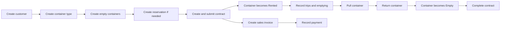

# BADR Container Management

## Simple User Guide

This application manages BADR Container's containers, rental contracts, trips, movements, reservations, trucks, payments, refunds, and commissions.

Open the application from **Desk > Container Management**.

## Main workflow

A reservation is optional. A customer can proceed directly to a contract when a container is available.

## Before daily use

An administrator should prepare these records once:

1. **Company and chart of accounts** in ERPNext.
2. **Customers** in the standard ERPNext Customer list.
3. **Rental Item** in the standard ERPNext Item list. This item is used on rental invoices.
4. **Container Types**, such as 20 FT, 40 FT, and 40 FT High Cube.
5. **Containers**, one record for each physical container.
6. **Vehicles and Drivers** for trucks and drivers. The app uses ERPNext's standard Vehicle and Driver records.
7. **Tax templates**, when prices include or exclude VAT.
8. **Users and roles** for operations, accounts, fleet management, and reporting.

## Container records

Create one **Container** record for each physical container. Give it a clear ID, select its type, and add its condition and remarks.

New containers must begin as **Empty**. The current customer, contract, location, and status are updated by submitted transactions. Staff should use movements and contracts instead of changing these values manually.

### Container statuses

| Status | Meaning |
| --- | --- |
| Empty | Available and not assigned to a customer |
| Rented | Assigned to an active customer contract |
| Late | The rental end date has passed while the container is still rented |
| Pull | The container has been requested or collected for return, but the rental assignment has not been closed |

## Reservations

Use **Rent Reservation** when a customer wants to reserve capacity before signing a contract.

1. Click **New Reservation**.
2. Select the customer and container type.
3. Enter the reservation period, quantity, and rate.
4. Optionally select a specific container. A specific container reservation must have quantity 1.
5. Save and submit the reservation.
6. Use **Confirmed** when the customer confirms.
7. Use **Completed** after the reservation has been fulfilled.

The system prevents overlapping reservations when there are not enough empty containers. Cancelled and completed reservations no longer reserve capacity.

## Rental contracts

Use one **Container Contract** for Rubble, Trash, or Unlimited Contract.

### Rubble and Trash contracts

Enter:

- Customer, company, currency, location, and dates
- Container or containers
- Number of trips and rate
- Rental Item
- Tax treatment and tax template when applicable

The basic amount is:

`Number of Trips × Rate = Total`

When several containers are added, the contract totals their trip quantities and amounts.

### Unlimited contracts

Unlimited contracts do not have a trip limit. Enter the customer, location, dates, Rental Item, tax information, and the amount to invoice for the current billing period.

The application does not decide the monthly or recurring billing schedule. Accounts staff should create each invoice according to the agreed billing cycle.

### Tax treatment

| Tax treatment | Result |
| --- | --- |
| Price Includes Tax | The entered amount already includes VAT |
| Price Excludes Tax | VAT is added to the entered amount |
| Exempt | No VAT is added |

Tax calculations use ERPNext's Sales Taxes and Charges Template and Sales Invoice calculation engine.

### Submitting a contract

1. Save the contract and review its amount, containers, dates, and tax treatment.
2. Submit it.
3. Containers listed in the contract become **Rented** and are linked to the customer and contract.

A container cannot be assigned if it is already rented, reserved for another customer, or assigned to another active contract.

## Container movements

Every physical change should be recorded in **Container Movement**. This creates the container's historical timeline.

| Movement | Use it when | Container result |
| --- | --- | --- |
| Delivery | Delivering an empty container to a customer | Rented |
| Transfer | Moving a rented container between locations | Assignment stays active; location changes |
| Pull or Pickup | Collecting or preparing to collect the container | Pull |
| Return | Closing the physical rental and returning the container | Empty; customer and contract are cleared |
| Emptying | Recording an emptying operation | Rental assignment remains active |
| Replacement | Use the Container Replacement form instead | Old container returns and new container is rented |

Use the workspace quick actions **Pull Container** and **Return Container** for common movements.

Movements must be entered in time order. If a submitted movement must be cancelled, cancel later dependent operations first. Cancellation restores the container's previous state.

## Trips

Use **Container Trip** for operational trips.

1. Select the customer, contract, container, truck, and driver.
2. Enter pickup and delivery information.
3. Keep planned, assigned, and in-transit trips as drafts.
4. Set the status to **Delivered** or **Returned** and submit the trip after it is completed.

Each submitted completed trip uses one trip from a limited contract.

Example:

- Allowed trips: 10
- Completed trips: 3
- Remaining trips: 7

The system stops additional trips when the limit is reached. A Container Manager can permit extra trips by selecting the override option and entering a reason. Unlimited contracts do not have a trip limit.

A trip with status Returned means the trip is finished. It does not end the customer's rental. Use a **Return** movement to make the physical container Empty.

## Emptying a container

Use **Container Emptying** to record the emptying date, location, condition before and after, charges, and remarks.

Submitting an emptying record keeps the container assigned to the same customer and contract. It does not return the container to inventory.

## Replacing a container

Use **Container Replacement** when a customer keeps the rental but receives a different container.

1. Select the customer and active contract.
2. Select the old rented container.
3. Select a different empty container.
4. Enter the date, reason, conditions, and any charge.
5. Submit the replacement.

The old container becomes **Empty**, and the new container becomes **Rented** under the same customer and contract.

## Pulling and returning a container

These are two separate steps:

1. Submit a **Pull** movement when the container is requested or collected for return. Its status becomes Pull, but its customer and contract remain linked.
2. Submit a **Return** movement when the return is complete. Its status becomes Empty, and its customer and contract are cleared.

This separation shows which containers are still in the return process.

## Completing a contract

A Container Manager can use **Complete Contract** after every assigned container has been returned.

The system will not complete a contract while it still has assigned containers. Submitted invoices remain in ERPNext and must be handled according to normal accounting procedures.

## Invoices and payments

### Create an invoice

1. Open an active submitted contract.
2. Click **Create Sales Invoice**.
3. Review the draft invoice, taxes, dates, and accounts.
4. Submit the Sales Invoice after approval.

For a fixed-trip contract, the contract action creates one normal rental invoice. Unlimited contracts may create repeated invoices using the current unlimited billing amount.

### Record a payment

Use ERPNext **Payment Entry** and allocate the receipt to the Sales Invoice. The app uses ERPNext's accounting ledger and does not keep a separate payment balance.

Use these standard reports for financial review:

- **Accounts Receivable** for customer outstanding balances
- **General Ledger** for customer statements
- **Sales Register** for sales and tax information
- **Payment Entry** for receipts and refunds

## Client withdrawals and refunds

A **Client Withdrawal** documents a customer refund already posted through ERPNext.

1. Create and submit a Payment Entry with Payment Type **Pay** for the customer.
2. Create Client Withdrawal.
3. Select the same customer, contract, and Payment Entry.
4. Enter the amount and reason, then submit.

The withdrawal record provides traceability. The Payment Entry remains the accounting transaction.

## Commissions

### Commission Rule

Create a rule for a Sales Person using either:

- Percentage of invoice net amount, or
- Fixed amount

A rule can apply to all customers, one customer, or one contract. Enter its effective dates and mark it active.

### Commission Entry

Create a Commission Entry after the related Sales Invoice is submitted. Select the contract, customer, sales person, invoice, and rule. The system calculates the amount and prevents a duplicate entry for the same invoice and sales person.

Commission Entry records the amount owed. Any actual commission payment should be posted through standard ERPNext accounting.

## Truck and fleet work

Use **Vehicle** for the truck master and **Driver** for drivers.

| Record | Purpose |
| --- | --- |
| Truck Oil Change | Oil-change date, kilometre reading, next service, supplier, and cost |
| Truck Permit | Permit number and expiry date |
| Truck KM Reading | Historical odometer readings |
| Purchase Invoice with Truck | Supplier expense posted to a specific truck |

Odometer readings normally cannot decrease. The Fleet Maintenance Due Report shows oil changes within 1,000 KM and expiry dates within 30 days, as well as overdue items.

## Dashboard and reports

The workspace dashboard shows:

- Total, Empty, Rented, Late, and Pull containers
- Active contracts
- Outstanding invoice balance
- Today's trips
- Pending returns

Useful operational reports include:

- Container Status Report
- Rented, Empty, Delayed, and Pull Containers Reports
- Container Movement Report
- Container Replacement Report
- Emptying Report
- General Contract Report
- Contract Trip Report
- Contract Payment and Outstanding Reports
- Commission Report
- Truck, Oil Change, Permit, KM, Spending, and Maintenance Due Reports

Use report filters to narrow results by customer, contract, container, date, or status.

## User roles

| Role | Main responsibility |
| --- | --- |
| Container Operator | Daily contracts, reservations, movements, trips, emptying, and replacement work |
| Container Manager | Operational control, cancellations, contract completion, and trip-limit overrides |
| Container Reports User | Read operational records and reports |
| Accounts User / Accounts Manager | Invoices, payments, refunds, commissions, and financial reports |
| Fleet Manager | Vehicles, oil changes, permits, kilometre readings, and fleet reports |

Users may also need access to linked ERPNext records such as Customer, Item, Company, Vehicle, and Driver.

## Common problems

### “Container is already assigned”

The container is Rented, Late, Pull, or otherwise linked to an active rental. Complete its Return movement before using it for another customer.

### “Insufficient available containers”

There are not enough Empty containers of that type for the requested reservation period. Reduce the quantity, change the dates, or make another container available.

### “Contract trip limit has been reached”

The completed trip count has reached the contract allowance. A manager can approve extra trips with an override reason, or the contract must be amended according to company policy.

### A container is still rented after a returned trip

Trip status does not close the rental. Submit a Container Movement with type **Return**.

### Contract cannot be completed

One or more containers are still assigned to it. Return every container first.

### Invoice cannot be created

Check that the contract is active and submitted, and that Company, Currency, Rental Item, and required tax template are set.

### Movement cannot be cancelled

A later movement or dependent operation exists. Cancel records from newest to oldest.

## Recommended daily routine

At the start of the day:

1. Review Today's Trips, Pending Returns, Late Containers, and Fleet Maintenance Due.
2. Assign trucks and drivers to draft trips.
3. Check reservations due to start.

During the day:

1. Record deliveries, transfers, pulls, returns, emptying, and replacements as they happen.
2. Complete and submit delivered trips.
3. Enter new kilometre readings and maintenance records.

At the end of the day:

1. Confirm that submitted movements match physical container locations.
2. Review incomplete trips and Pull containers.
3. Check invoices, receipts, and outstanding balances with Accounts.

## Important operating rule

The **Container** record shows the current physical state. Submitted **Container Movement** and related transactions provide the history. Always record the business event through its transaction form so the current state and history remain consistent.
